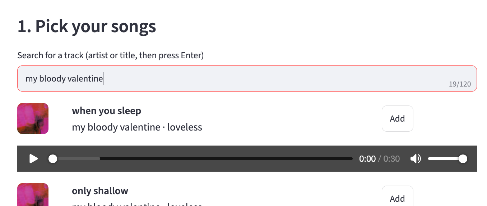
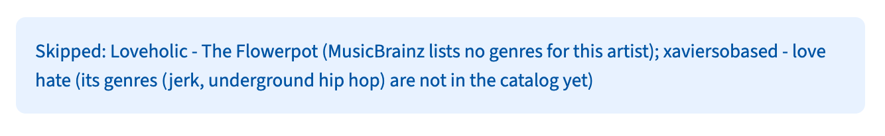

# Original Project
<!--- text here--->

# Know Your New Favorite Songs At Every Age
> *The title is based off the song *Know Who You Are At Every Age*, from the album **Four-Calendar Cafe** by Cocteau Twins.*

This is a recommendation model based on your favorite genres and listening habits. The model, Gemini, makes assumptions based on the songs you input (max 5), and then looks for albums with similar genres.
It uses MusicBrainz and Wikipedia for information. Originally, I had wanting to use RateYourMusic or Album of the Year, but they forbid scraping.

> You can also get a preview of the songs available, and get an audio preview before you select. 
> **Note:** The volume is very very loud!



I chose this idea because I wanted a tool that can make it easier to find new music based on the songs you already enjoy. I think haivng a tool that looks at genres and energy can be helpful for exploring not only albums of the same genre, but maybe they have other subgenres worth checking out.

## Architecture

[link to mermaid diagram](diagrams/architecture.mmd)

The first phase builds a dataset, and then the second phase uses that dataset to make music recommendations.

1. The person writes the list of albums into a CSV, and the model clients attempt to fetch data from the sources (MusicBrainz, Wikipedia, Wikidata). The system saves these responses into `raw/`.
    - Later it compares the genre labels, and then writes a JSON file with confidence scores and problems when calculating confidence.

2. Your inputs are checked, and the system looks up those genres. It scores the albums JSON again, and reads previous feedback.
    - When there is not enough data to make a decision, it replies "not enough data", instead of randomly guessing.
    - You will receive albums, one from each (new) artist.
    - The model will make a description of the model based on the album, so you can have more context or get a feel of what the album sounds like.
    - Finally, the results are shown in cards, with the album name, genre, reasoning for why it's a match, the description of the album, and its confidence score. You can give feedback, which adjusts the confidence score.


For certain albums it recommends, it may have missing album artwork and low matches will have this in the description -- `Check this data: sources_disagree_on_genre`.

## Setup
To set up the system, create the virtual environment and activate it, and install the [requirements](requirements.txt).
```bash
python3 -m venv .venv && source .venv/bin/activate
pip install -r requirements.txt

.scripts/demo.sh # CLI demo with 5 sample songs
./scripts/demo.sh app # runs an instance of Streamlit, webapp
pytest # 14+ tests
```
You can also choose to enter your own songs and correct those recommendations through the command line.
```bash
# -k [number] = how many albums
python -m src.cli "Slowdive - Alison" "David Bowie - Heroes" -k 10

# rating/correcting recommendations
python -m src.cli --rate <album-id> up` and `python -m src.cli --correct <album-id> --add "dream pop" --remove rock
```
### (optional API setup)
You can set a `GEMINI_API_KEY` (free key at https://aistudio.google.com/apikey) or `ANTHROPIC_API_KEY` in `.env` for better recommendations. Gemini is used by default.

## Sample Interactions
```bash
=== Cocteau Twins - Know Who You Are at Every Age Joy Division - Disorder -k 3
2026-11-17 16:51:49,474 INFO rag.pipeline req=e5919cba songs=2 resolved=2 k=3 top=['the-cure--disintegration', 'the-chameleons--script-of-the-bridge', 'slowdive--souvlaki
2026-11-17 16:51:49,474 INFO rag.pipeline req=e5919cba done results=3 llm=True seconds=0.94
3 results (0.94 seconds)

 1. The Cure - Disintegration (1989)  match 84%  confidence 100%
    genres: gothic rock, alternative rock, post-punk, new wave
    why: Fits your taste in Joy Division through shared genres: gothic rock, post-punk, new wave.
    This gothic rock and alternative rock album marks a return to the band's introspective early 1980s style, creating and sustaining a mood of self-absorbed gloom. Conte
    id: the-cure--disintegration

 2. The Chameleons - Script of the Bridge (1983)  match 66%  confidence 60%  [sources_disagree_on_genre]  [AI-suggested, verified]
    genres: post-punk, gothic rock, new wave, rock
exit=
```

```bash
=== Slowdive - Alison
2026-11-17 16:51:54,354 INFO rag.pipeline req=53f6c0f8 rejected input: Enter between 2 and 5 songs.
2026-11-17 16:51:54,354 INFO rag.pipeline req=53f6c0f8 done results=0 llm=False seconds=0.00
Enter between 2 and 5 songs.
exit=
```

```bash
6 results (1.61 seconds)
Your songs have in common: hip hop (Kendrick Lamar, Nas)

 1. Joy Division - Unknown Pleasures (1979)  match 54%  confidence 100%
    genres: gothic rock, post-punk, rock, new wave
    why: Fits your taste in The Cure through shared genres: gothic rock, post-punk, new wave.
    This debut studio album by Joy Division features a distinctive post-punk and gothic rock sound shaped by producer Martin Hannett's unconventional recording techniques. It was released in June 1979 through Factory Records.
    id: joy-division--unknown-pleasures

 2. A Tribe Called Quest - The Low End Theory (1991)  match 51%  confidence 76%
    genres: hip hop, jazz rap, east coast hip-hop, alternative hip-hop
    why: Fits your taste in Kendrick Lamar + Nas through shared genres: hip hop, jazz rap, east coast hip hop. It also echoes what your songs have in common (hip hop).
    A foundational release in alternative hip-hop and jazz rap, this album showcases the style of the pioneering American group formed in Queens, New York City. The group emerged as prominent members of the Native Tongues collective.
    id: a-tribe-called-quest--the-low-end-theory

 3. The Chameleons - Script of the Bridge (1983)  match 46%  confidence 60%  [sources_disagree_on_genre]  [AI-suggested, verified]
    genres: post-punk, gothic rock, new wave, rock
    why: Fits your taste in The Cure through shared genres: gothic rock, post-punk, new wave.
    Script of the Bridge is the debut studio album by the English rock band The Chameleons, released in 1983. It features a sound rooted in post-punk, gothic rock, and new wave.
    id: the-chameleons--script-of-the-bridge

 4. Nujabes - Metaphorical Music (2003)  match 45%  confidence 100%
    genres: cool jazz, trip hop, hip hop, downtempo
    why: Fits your taste in Miles Davis + Nas through shared genres: hip hop, cool jazz, jazz. It also echoes what your songs have in common (hip hop).
    This debut studio album by Japanese musician Nujabes offers a combination of hip hop and instrumental jazz. While classified roughly as an instrumental hip hop album, it features contributing vocals from several artists.
    id: nujabes--metaphorical-music

 5. Boards of Canada - Music Has the Right to Children (1998)  match 42%  confidence 68%
    genres: electronic, techno, idm, intelligent dance
    why: Fits your taste in Aphex Twin through shared genres: ambient techno, techno, idm.
    Produced at the duo's personal recording studio, this electronic album features vintage synthesizers and moody, edgy, weirdly beautiful ambient soundscapes. It was received positively by critics as a landmark in emotive electronica packed with warm and human material.
    id: boards-of-canada--music-has-the-right-to-children

 6. Madvillain - Madvillainy (2004)  match 41%  confidence 70%
    genres: jazz rap, alternative hip-hop, underground hip-hop, experimental hip-hop
    why: Fits your taste in Kendrick Lamar through shared genres: jazz rap, experimental hip-hop, hip hop. It also echoes what your songs have in common (hip hop).
    This critically acclaimed collaboration between MF Doom and Madlib features unconventional beat orchestrations paired with unpredictable lyrical styles. Critics praised its mix of obtuse beats, samples, and straight-up hip-hop bumping.
    id: madvillain--madvillainy

exit=0
```

## Design Decisions
<!---  Design Decisions: Why you built it this way, and what trade-offs you made. --->
I thought about the same sort of algorithm during the summer, but for this project, I wanted to have a stronger emphasis on multiple songs of the same genre, giving those a better score.

**How it is scored:**
$\text{score} = 0.45 * \text{similarity} + 0.20 * \text{bridge} + 0.20 * \text{rating} + 0.10 * \text{confidence} + \text{feedback\_adjustment}$

I wanted to derive data from music boards and sites such as Last.fm and RateYourMusic in particular, since it has community-reviewed genres and descriptors, but due to their scraping policies, I did not want to break their terms of service as a user. I think not having RYM metadata was one of the bigger tradeoffs I had to make.

Claude did suggest using openly available websites such as MusicBrainz and Wikipedia to scrape, so the information is minimal and may be somewhat incorrect, but sufficient for the purposes of this implementation.

## Testing Summary
<!---  What worked, what didn't, and what you learned. --->
Surprisingly, it did give me some albums I already know about. I would have asked Claude to implement a chart on how the Python system scores the albums, because a `74%` match does not say much.

Some errors that may occur are missing genres from the MusicBrainz database, or any subgenres other than rock, pop, rap, etc. This makes it difficult for certain songs to get recommendations.
> 

I learned that there are many caveats to finding new music using algorithms and RAG systems. Some websites may not have any or accurate data.

## Reflection
I think it was interesting to use AI to implement a RAG client, and it seems more useful that scraping and writing a ton of algorithms. I think the current approach for my project is not the best, but I think inputting songs VS asking a chatbot may seem more fun.

There were definitely a bunch of errors, but I think asking a chatbot why things break is more helpful than automatically accepting every change. The **plan mode** and the **STE skill** in Claude made problems easier to understand.