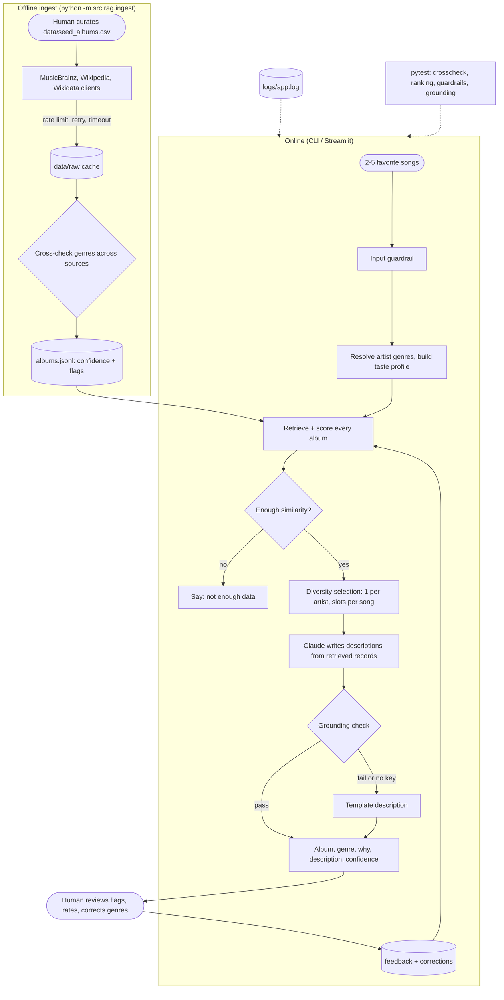

# Original Project
<!--- text here--->

# Know Your New Favorite Songs At Every Age
> *The title is based off the song *Know Who You Are At Every Age*, from the album **Four-Calendar Cafe** by Cocteau Twins.*

This is a recommendation model based on your favorite genres and listening habits. The model, Gemini, makes assumptions based on the songs you input (max 5), and then looks for albums with similar genres.
It uses MusicBrainz and Wikipedia for information. Originally, I had wanting to use RateYourMusic or Album of the Year, but they forbid scraping.

I chose this idea because I wanted a tool that can make it easier to find new music based on the songs you already enjoy. I think haivng a tool that looks at genres and energy can be helpful for exploring not only albums of the same genre, but maybe they have other subgenres worth checking out.

## Architecture

[link to mermaid diagram](diagrams/architecture.mmd)

The first phase builds a dataset, and then the second phase uses that dataset to make music recommendations.

1. The person writes the list of albums into a CSV, and the model clients attempt to fetch data from the sources (MusicBrainz, Wikipedia, Wikidata). The system saves these responses into `raw/`.
    - Later it compares the genre labels, and then writes a JSON file with confidence scores and problems when calculating confidence.

2. Your inputs are checked, and the system looks up those genres. It scores the albums JSON again, and reads previous feedback.
    - When there is not enough data to make a decision, it replies "not enough data", instead of randomly guessing.
    - You will receive albums, one from each (new) artist.
    - The model will make a description of the model based on the album, so you can have more context or get a feel of what the album sounds like.
    - Finally, the results are shown in cards, with the album name, genre, reasoning for why it's a match, the description of the album, and its confidence score. You can give feedback, which adjusts the confidence score.

## Setup
To set up the system, create the virtual environment and activate it, and install the [requirements](requirements.txt).
```bash
python3 -m venv .venv && source .venv/bin/activate
pip install -r requirements.txt

.scripts/demo.sh # CLI demo with 5 sample songs
./scripts/demo.sh app # runs an instance of Streamlit, webapp
pytest # 14+ tests
```
You can also choose to enter your own songs and correct those recommendations through the command line.
```bash
# -k [number] = how many albums
python -m src.cli "Slowdive - Alison" "David Bowie - Heroes" -k 10

# rating/correcting recommendations
python -m src.cli --rate <album-id> up` and `python -m src.cli --correct <album-id> --add "dream pop" --remove rock
```
### (optional API setup)
You can set a `GEMINI_API_KEY` (free key at https://aistudio.google.com/apikey) or `ANTHROPIC_API_KEY` in `.env` for better recommendations. Gemini is used by default.

## Sample Interactions
```bash
```

```bash
```

```bash
```

## Design Decisions

## Testing Summary
### Potential errors
- Some subgenres such as Shimokita-kei or math rock are not recognized by the model.
- Not all songs may be logged into the Wikipedia or MusicBrainz database.

## Reflection

<!---
Enter 2-5 favorite songs from any genres. The system retrieves album data from open music APIs, cross-checks it, ranks 10-20 albums, and explains each pick (genre, why it fits, a short description).

**Data sources (API only, no scraping):** MusicBrainz, Wikipedia, Wikidata. RateYourMusic and Album of the Year have no public API and forbid scraping, so they are intentionally not used.

## Run it

**AI discovery (optional, needs a key):** tick "Let AI suggest extra albums" in the app, or pass `--discover` on the CLI. The LLM only *suggests* candidates; each one must match a MusicBrainz release and have genre data, otherwise it is rejected (this blocks made-up albums). Verified albums go through the same cross-check, are labelled "AI-suggested, verified", and are saved to `data/discovered.jsonl` so later searches are fast. First search takes up to ~40s extra (rate-limited APIs, capped by a time budget); repeats take a few seconds.

**Refresh the data** (needs network, ~5-10 min because APIs are rate-limited): `MB_CONTACT=you@example.com python -m src.rag.ingest --refresh`. The committed `data/raw/` cache means a normal clone needs no network.

## How data flows

--->

<!---
## How ranking works

`score = 0.45 × profile similarity + 0.20 × bridge + 0.20 × rating + 0.10 × confidence + feedback`

- **Profile similarity:** genre vectors weighted by rarity (a tag like "rock" counts less than "dream pop"), compared to the sum of your songs' tags.
- **Bridge:** the share of your songs an album relates to, so albums connecting several of your tastes rank higher.
- **Selection:** artists you entered are excluded, at most one album per artist, and each song's taste gets reserved slots.
- **Feedback:** each 👍/👎 moves an album by ±0.05, capped at ±0.15.

## Guardrails and logging

- Input validation (2-5 songs, `Artist - Song`, length caps); weak matches return "not enough data" instead of guesses.
- Cross-check flags (`single_genre_source`, `sources_disagree_on_genre`, `low_confidence`) are shown, not hidden.
- LLM output is validated (known ids only, no numbers absent from the data); any failure falls back to templates.
- Network: User-Agent, timeouts, bounded retries, per-host rate limits; one failing source never aborts ingest.
- Feedback files are append-only; corrections are applied over, never into, the raw data.
- Logs go to the console and `logs/app.log` (request id, resolved songs, top results, fallback used, latency).

## Known limits (v1)

- A song is resolved to its **artist's** genres, not the specific track.
- Rating cross-check needs a second rating source (only MusicBrainz ratings today).
- Catalog is ~85 curated albums plus whatever AI discovery has verified so far; without discovery, recommendations come only from it.
- AI discovery adds at most 6 albums per search, and the LLM's suggestions vary between runs.
- Original starter song recommender remains in `src/recommender.py` (`python -m src.main`).
--->