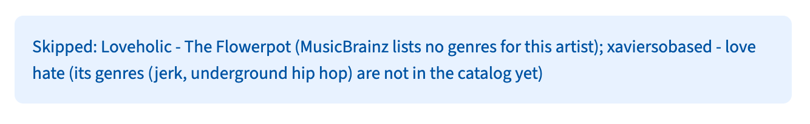

# 🎧 Model Card: Music Recommender Simulation

## 1. Model Name  

> Give your model a short, descriptive name.  

**Know Your New Favorite Songs At Every Age**: A recommendation model based on your favorite genres and listening habits
> (name is based off the song *Know Who You Are At Every Age*, from the album **Four-Calendar Cafe** by Cocteau Twins)

---

## 2. Intended Use  

> Describe what your recommender is designed to do and who it is for.

The recommender is designed to generate new recommendations of music based on your favorite tracks and genres. It makes assumptions based on your listening habits, such as the songs you like and the search terms in your history to further personalize your preferences and user profile.

This is meant as an experimental system, and could be integrated with Last.fm and Album Of The Year in the near future, including an optional reviews section to see if others like the album.

---

## 3. How the Model Works  

> Explain your scoring approach in simple language.

The main features noted are the genre and the amount of plays. Songs that are within the genre get an small extra weight, since the genre is an umbrella term, we cannot assume that users would enjoy subgenres.

BPMs of songs are also considered, and the result will show whether the user enjoys faster or slower tracks.

The model calculates the bonus points from the favorite genre by adding the genre's score (`+ 1.0`), followed by an incremental multiplier. The more the user engages with a certain genre, the score will scale alongside that genre to create a better ranking.

---

## 4. Data  

> Describe the dataset the model uses. 
### Before the model
I did not add new columns from the previous music recommendation assignment, but I included some songs from David Bowie, The Velvet Underground, The Beatles, and Joy Division to have a diverse mix into the dataset. However, most of the songs added are mostly `rock`, with the exception of a song by David Bowie that is `pop`.

### Using the model
It creates a dataset based on songs you input, and will return new albums.

---

## 5. Strengths  

> Where does your system seem to work well  

Prompts:  

- User types for which it gives reasonable results  
- Any patterns you think your scoring captures correctly  
- Cases where the recommendations matched your intuition 

I think the recommendations give some decent descriptions on what the album is, but some of the albums just explain that "this album is a release by X, who is a Y".

Two examples:
- **great:** Drawing from R&B and dance styles such as UK garage, drum and bass, Baltimore, and Jersey club, this EP features a sound characterized by lively beats and synthesizers.
- **not very descriptive:** This album is a release by South Korean singer Taeyeon, who debuted as a member of the girl group Girls' Generation. 

---

## 6. Limitations and Bias 

> Where the system struggles or behaves unfairly.

As shown in this screenshot, the limitations are mostly that some metadata of the album cannot be found on the database, or the genres are not available in the system. In the future, this could be improved by finding an umbrella genre and treating these genres like `jerk` and `math rock` as subgenres.

I'm not sure whether the model is able to be misued since there isn't a chat functionality between the user and the model. However, there can be safeguards in the future against offensive music.

I think the most interesting thing is that I input my own favorite songs and it came back with surprisingly: albums that I have encountered or enjoyed in the past. This, of course, cannot be said for everyone, hence the feedback feature implemented on the album cards, and the options to correct the genres.

I mainly architected the system with Claude and followed my intuition and ideas of what I wanted to implement. I did ask it initially to see if there was a way to use Last.fm and RateYourMusic, two great music platforms, as databases, but it suggested using other websites because of the anti-scraping policies on those two websites.

I decided that even though Wikipedia was not the best source for most songs, there were still important metadata such as genres, descriptions for songs by critics, etc.

---

## 7. Evaluation  

> How you checked whether the recommender behaved as expected. 

In the recommendations, I tried looking at the reasoning behind some of the confidence scores, and it surprised me that some confidence was very high, and some were very low. It might have been based on being biased towards songs with more related geres.

Though, the model seemed to provide good results, such as bridging recommendations through share songs, for example:
- Miles Davis - jazz
- Nas - rap
- **Result:** Nujabes - jazz rap

---

## 8. Future Work  

> Ideas for how you would improve the model next.  

There are definitely better ways to give recommendations
1. Giving users the freedom to choose their own providers through API keys. Certain chatbots such as Gemini and Perplexity may excel in search tasks.
2. Genres, such as `math rock`, can be a subgenre of `rock` and subsequently other genres. It may be helpful to attach a graph-view with nodes of genres connected to each other. When clicking on a neighboring genre node, it could also show similar sounding/feeling albums.

I would like to also add audio previews of the most notable track, so users can get a quick taste of the recommended albums.

---

## 9. Personal Reflection  

> A few sentences about your experience.  

I think it's interesting how recommendation systems work. When I use Spotify or YouTube, a lot of the results are not 100% perfect the first time, but it may start to adapt through personalization.

I learned that recommendation systems utilize some RAG and personalized data to make guesses on what you enjoy, almost like patterns.